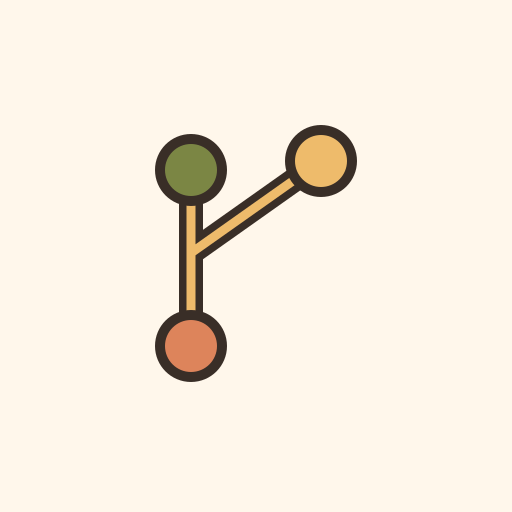

<div align="center">



🐙

# gh


**The @kud/gh family — GitHub PR tooling: core, Ink components, and CLIs.**

<a href="https://kud.io/projects/gh">Website</a> · <a href="https://kud.io/projects/gh/docs">Documentation</a>

</div>

## Features

The **gh family** — GitHub PR tooling as a layered, reusable ecosystem. A surface-agnostic core, Ink components, and thin CLIs, so the logic lives once and every surface (standalone command, cockpit dashboard, MCP) consumes it.

- **Surface-agnostic core** — shells out to `gh` and returns plain data, with the `ghGraphql` / `ghRest` primitives every tool used to reinvent
- **Ink components** — presentation-only panels, the inbox shell and whose-move banding
- **A configurable cockpit** — your PRs, reviews and issues in one TUI
- **Thin CLIs** — browse and resolve review threads, check a PR's health, replay a webhook delivery
- **Empty defaults** — the host supplies every opinion, nothing assumes its author's repos

## Install

Each package installs on its own (Node.js >= 22):

```sh
npm install -g @kud/gh-pr-comments
npm install -g @kud/gh-pr-health
npm install -g @kud/gh-webhook-replay
npm install @kud/gh @kud/gh-ink @kud/gh-cockpit
```

## Packages

| Package                                                | Role                                                                                          | Version                                                                                           |
| ------------------------------------------------------ | --------------------------------------------------------------------------------------------- | ------------------------------------------------------------------------------------------------- |
| [`@kud/gh`](packages/gh)                               | **core** — `gh` CLI primitives, PR review comments, health, webhook logic                     |                 |
| [`@kud/gh-ink`](packages/gh-ink)                       | **components** — controlled Ink panels, the inbox shell, whose-move banding, token→colour map |             |
| [`@kud/gh-cockpit`](packages/gh-cockpit)               | **app** — a configurable cockpit: your PRs, reviews and issues in one TUI                     |         |
| [`@kud/gh-pr-comments`](packages/gh-pr-comments)       | CLI — browse / reply / resolve review threads                                                 |     |
| [`@kud/gh-pr-health`](packages/gh-pr-health)           | CLI — checks / reviews / merge-state for a PR                                                 |       |
| [`@kud/gh-webhook-replay`](packages/gh-webhook-replay) | CLI — replay the latest `pull_request` webhook delivery                                       |  |

## Design

- **Core** (`tsc`, zero-UI): shells out to `gh` and returns plain data. The
  `ghGraphql` / `ghRest` primitives every tool used to reinvent now live here.
- **Ink layer** (`tsup`): presentation-only components — props in, no fetching,
  no input. The consuming surface owns selection, navigation, and loading.
- **App** (`@kud/gh-cockpit`): the cockpit's views and config surface, with no
  opinion about whose repos matter or which searches are tabs — the host says.
- **CLIs**: arg-parsing + mounting the Ink body over a core client.

The core emits **semantic tokens**; the Ink layer maps token → colour. Same seam
as `@kud/jenkins` → `@kud/jenkins-ink`.

Every layer's defaults are **empty rather than convenient**. A library that ranks
its author's repos first, or guesses where checkouts live, is wrong for its
second reader — so the host supplies all of it through `configureInbox`. See
[building a cockpit](packages/gh-cockpit#-build-your-own-cli).

## Development

```sh
npm install          # install all workspaces
npm run typecheck    # across packages
npm run test
npm run build
```

Versioning & publishing is per-package via [changesets](https://github.com/changesets/changesets):

```sh
npm run changeset          # record a change
npm run version-packages   # apply version bumps
npm run release            # build + publish changed packages
```

## Licence

MIT © Erwann Mest

📚 **Full documentation → [gh/docs](https://kud.io/projects/gh/docs)**
